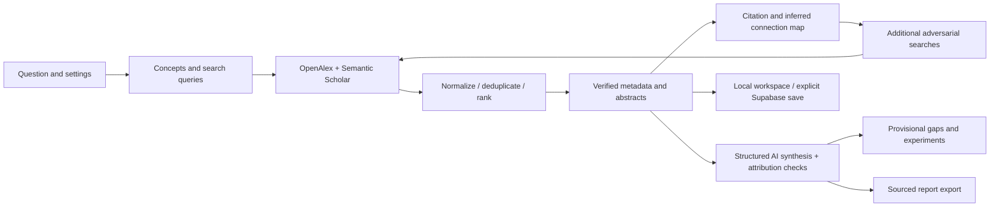

# GapForge AI

**Explore the literature. Challenge the idea. Discover what comes next.**

GapForge is an implemented research-workspace MVP built around a skeptical literature workflow. It retrieves provider records, separates metadata from interpretation, runs adversarial novelty searches, maps citations, and exports sourced reports. It does not establish that an idea is original, and it does not analyze full text.

## Implemented workflow

- Responsive dark/light landing page and research dashboard with genuine empty states.
- Question/proposal input, field detection, year bounds, search depth, and paper limits.
- OpenAlex and Semantic Scholar adapters, multiple queries, pagination, bounded retries, timeouts, partial-provider recovery, caching, identifier normalization, deduplication, and word-overlap ranking.
- NDJSON progress events emitted by actual backend operations. Cancellation and a browser-saved draft support safe retries; incomplete responses never create a completed project.
- OpenAI Responses API Structured Outputs, Zod validation, abstract-level evidence excerpts, categorical novelty assessment, tentative gaps, and provisional question revisions.
- A separate **Challenge My Idea** search, including challenges focused on selected network papers or topic groups. Retrieved challenge papers join the project map.
- Interactive Cytoscape map: directed citation arrows, bibliographic coupling, co-citation within the retrieved set, and explicitly inferred word-overlap links. Zoom, pan, drag, selection, filters, topic groups, group comparison, timeline layout, backward reference traversal, reference expansion, session pinning, saved positions, PNG export, and keyboard-accessible selectors.
- Filterable literature list, original-source/open-access links, missing-abstract handling, bibliography copying, bookmarks, reading queue, notes, and search history.
- Editable experiment proposals with controls, baselines, metrics, statistical analysis, resources, a six-month timeline, and JSON export.
- Project assistant with clickable references and an explicit additional-literature-search action.
- Browser-local projects, account-separated local caches, explicit guest import, email/password Supabase authentication, explicit cloud saves, and cloud reload.
- PDF, Markdown, and BibTeX export with source identifiers and limitations.
- SQL schema with 15 RLS-protected tables, composite ownership foreign keys, indexes, and an atomic security-invoker save RPC. Paper metadata is reused across a user's projects.

## Local setup

Use Node.js **24 LTS** and npm. No provider key is needed to open the UI, manage local projects, or run deterministic tests.

```bash
git clone https://github.com/anishmanthena123/gapforge-ai.git
cd gapforge-ai
npm ci
cp .env.example .env.local
# Edit .env.local with your own provider configuration.
npm run dev
```

Open <http://localhost:3000>. To run the production server locally:

```bash
npm run build
npm run start
```

### Environment variables

| Variable                               | Purpose                                                                                                                          |
| -------------------------------------- | -------------------------------------------------------------------------------------------------------------------------------- |
| `OPENAI_API_KEY`                       | Server-only key for synthesis, chat, and experiments. AI features are unavailable without it.                                    |
| `OPENAI_MODEL`                         | Structured Outputs capable model; defaults to `gpt-4.1-mini`.                                                                    |
| `OPENALEX_API_KEY`                     | Primary literature provider key. Configure according to current OpenAlex authentication policy; authentication errors are shown. |
| `SEMANTIC_SCHOLAR_API_KEY`             | Optional server-only `x-api-key`; unauthenticated access is subject to provider limits.                                          |
| `NEXT_PUBLIC_SUPABASE_URL`             | Your dedicated Supabase project URL.                                                                                             |
| `NEXT_PUBLIC_SUPABASE_PUBLISHABLE_KEY` | Browser-safe publishable key.                                                                                                    |
| `NEXT_PUBLIC_SUPABASE_ANON_KEY`        | Legacy compatibility alternative to the publishable key.                                                                         |
| `ALLOW_GUEST_AI`                       | Defaults to false. Set true only for a trusted local installation if you want AI without sign-in.                                |
| `SUPABASE_SERVICE_ROLE_KEY`            | **Not used.** Leave unset; all database access uses the authenticated user's RLS context.                                        |

`NEXT_PUBLIC_*` values must be present **before building**, because Next.js embeds them in the client bundle. Never put provider credentials or privileged database keys in public variables. No real credentials are committed.

Without OpenAI, the app uses a labeled terminology heuristic for queries and does not generate replacement novelty verdicts. Without Supabase, local browser storage remains available. Provider failures never trigger fake research results.

### Supabase setup

Use a dedicated new/local Supabase project, not an unrelated existing production database. This delivery does not modify a hosted database.

1. Enable email/password authentication in your project. Configure the Site URL to your application's origin and confirmation redirects as needed.
2. Review and apply `supabase/migrations/20261111063834_gapforge_foundation.sql` through the Supabase SQL editor in that dedicated project, or your normal migration workflow. The file was created with Supabase CLI `migration new`.
3. Set the project URL and publishable key in `.env.local`; restart/rebuild.
4. Sign up/sign in in Settings. If email confirmation is enabled, confirm your address before signing in.
5. To bring guest work into your account, choose **Import guest projects** in Settings. Then open a project and choose **Save to cloud**. Local work is never silently uploaded.

The RPC validates ownership through RLS and composite foreign keys. The API re-fetches paper metadata from the providers before cloud save; unavailable evidence leaves the local copy intact. The app never uses a service-role key to bypass RLS.

## Architecture



- `src/app/`: App Router pages, server route handlers, layouts, loading/error states, theme tokens, and responsive CSS.
- `src/components/`: Connected workspace, research form, results/challenge/experiment UI, map, library, authentication, and account-scoped persistence.
- `src/lib/model.ts`, `literature.ts`, `graph.ts`, `integrity.ts`, `report.ts`: Validated contracts, provenance-preserving algorithms, graph computation, reference checks, and export.
- `src/lib/server/`: Provider HTTP handling, bounded caches, actual pipeline stages, structured AI calls, and normalized cloud loading.
- `src/lib/supabase/`: Browser and server clients; server auth verifies users with `getUser()`.
- `supabase/migrations/`: Normalized database and ownership policies.
- `tests/`, `e2e/`: Explicit deterministic fixtures, provider/graph/evidence/reliability tests, SQL access-control tests, and browser workflows. Fixtures are never imported by production code.

See [implementation and evidence boundaries](docs/IMPLEMENTATION.md), [validation](docs/VALIDATION.md), and [deployment](docs/DEPLOYMENT.md).

## Validation

```bash
npm run typecheck
npm run lint
npm test
npm run build
npx playwright install chromium
npm run test:e2e
```

If Chromium is already installed:

```bash
PLAYWRIGHT_CHROMIUM_EXECUTABLE_PATH=/usr/bin/chromium npm run test:e2e
```

The Playwright suite starts the production server; run the build first. SQL tests execute the actual migration and save RPC in PGlite with separate authenticated roles and user IDs. They do not connect to your hosted database. Browser and AI-response fixtures are explicitly labeled `TEST FIXTURE`.

## Known limits and next steps

This is a connected MVP, not an independently validated scientific-review service. The delivery environment blocked `api.openalex.org` and `api.semanticscholar.org`; live provider verification was unavailable. No live OpenAI calls or hosted Supabase schema changes were performed. Configure credentials/network access and run real integration checks before relying on results.

The review is metadata/abstract-only. Evidence validation checks source membership and exact excerpt presence, not semantic entailment. Word overlap is used instead of embeddings; metadata topics define groups. Contradiction and shared-methodology edges are deliberately not asserted without sufficient evidence. Co-citation and citation traversal are limited to retrieved records. Node pins last for the current view; saved positions persist. PNG graph export is available; SVG is not implemented. PDF export transliterates unsupported characters; Markdown preserves Unicode.

Jobs run inside the request with cancellation and a saved input for safe retry. The schema reserves `analysis_jobs` and `research_reports` for a future durable worker/report archive; those tables are not represented as active queueing features. There is no checkpoint-resume worker, continuous cloud synchronization, or in-app cloud deletion. Cloud reads initially load up to 100 projects and are intended for a modest personal catalogue.

Before a multi-instance public launch, add a durable worker, shared cache/throttling, user quotas and billing controls, paginated cloud loading, and live provider/auth deployment checks. See the deployment guide for the operational details. No application was deployed and no paid services were purchased.
